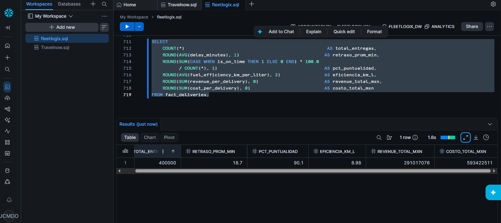

# FleetLogix — Ingeniería de datos para una empresa de logística

Proyecto Integrador del **Módulo 2 — Bases de Datos II (Henry)**.

Pipeline de datos de punta a punta para **FleetLogix**, una empresa de transporte y logística: desde una base transaccional en **PostgreSQL** hasta un **Data Warehouse en Snowflake** y una arquitectura cloud en **AWS**.

## Arquitectura

```
PostgreSQL (OLTP) ──► ETL en Python ──► Snowflake (modelo estrella) ──► KPIs / análisis
       │                                     
       └── MongoDB (telemetría de vehículos, datos semiestructurados)
                                              
AWS: API Gateway ─► Lambda ─► RDS PostgreSQL · DynamoDB · S3 ─► CloudWatch ─► SNS
```

## Avances

| # | Avance | Qué incluye |
|---|--------|-------------|
| 1 | **Generación de datos** | Esquema relacional de 6 tablas y generación de **505,000+ registros** sintéticos (2 años de operación): vehículos, conductores, rutas, viajes, entregas y mantenimiento. |
| 2 | **Análisis SQL y optimización** | Queries de negocio con CTEs y funciones de ventana (`LAG`, `NTILE`, `PARTITION BY`), ranking bayesiano de conductores, detección de descansos insuficientes, `EXPLAIN ANALYZE` antes/después de índices y vistas materializadas. |
| 3 | **Data Warehouse** | Modelo dimensional (estrella) en Snowflake con dimensiones de tiempo, cliente, conductor, vehículo y ruta, y la tabla de hechos `fact_deliveries`. ETL en Python con carga incremental y validaciones de calidad (**885,000+ registros** en el DW). Telemetría en MongoDB. |
| 4 | **Cloud AWS** | Diseño de arquitectura serverless con 9 servicios (API Gateway, Lambda, RDS, DynamoDB, S3, CloudWatch, SNS, IAM), scripts de configuración con boto3 y funciones Lambda (verificación de entregas, ETA, alertas de desvío). |



## Estructura

```
├── 01_generacion_datos/          # Esquema SQL, generador de datos (Python) y CSV de muestra
├── 02_analisis_sql/              # Queries de análisis, índices y notebook con EXPLAIN ANALYZE
├── 03_data_warehouse_snowflake/  # Modelo dimensional, pipeline ETL y capturas de Snowflake
├── 04_aws_cloud/                 # Setup de AWS (boto3) y funciones Lambda
└── docs/                         # README detallado de cada avance (PDF)
```

> Las tablas grandes (`trips`, `deliveries`, `fact_deliveries`) no se incluyen por tamaño; se regeneran con `01_generacion_datos/01_data_generation.py`.

## Tecnologías

PostgreSQL · SQL avanzado · Python (pandas, psycopg2, Faker) · Snowflake · MongoDB · AWS (Lambda, RDS, DynamoDB, S3, CloudWatch, SNS, boto3) · DBeaver · Jupyter

## Cómo ejecutarlo

1. Crear la base en PostgreSQL con `01_generacion_datos/fleetlogix_db_schema.sql`.
2. Configurar credenciales (usuario, contraseña, cuenta de Snowflake) en los diccionarios de conexión de cada script — **los valores del repo son placeholders**.
3. Ejecutar los notebooks en orden (Avance 1 → 4).

---
**Autor:** César Montes · [GitHub](https://github.com/czr46)
